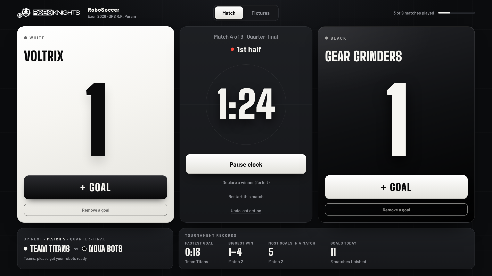
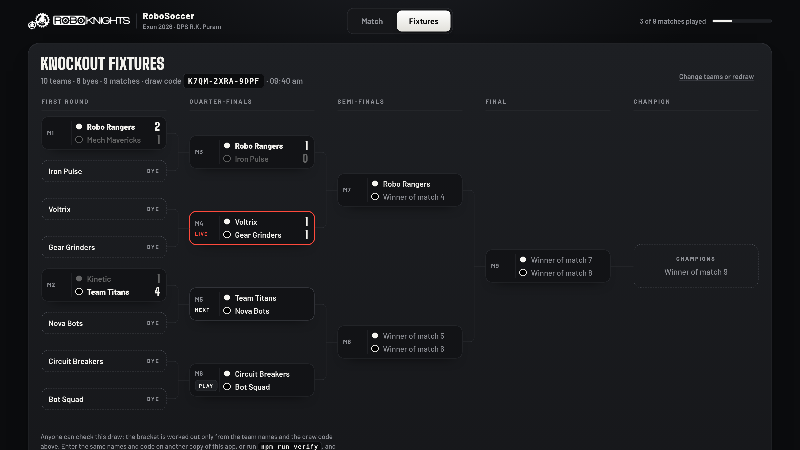

# RoboSoccer Scorer

Scoreboard and knockout manager for school robot football. I built it to run the RoboSoccer event at **Robotics at Exun 2026** (DPS R.K. Puram, 31 October 2026), hosted by RoboKnights, and used it on the day on a laptop mirrored to the hall projector.

**Try it:** https://ari191210.github.io/robosoccer-scorer/



## What it does

- **Runs a match.** Two 3-minute halves with a 1-minute break, 4-minute halves in the final, then golden goal and penalties if it is level. The operator presses one big button that always says what happens next: Start match, Pause clock, Start 2nd half, Start golden goal.
- **Draws the fixtures.** A random knockout bracket for 2 to 32 teams, with byes where the numbers need them. Winners move on by themselves when a match ends.
- **Shows the room what matters.** Score, clock, who plays next ("Teams, please get your robots ready"), and tournament records such as fastest goal and biggest win, announced on screen when they are broken.
- **Works without internet.** The whole app, fonts and logo included, builds into one HTML file.



## Three design decisions

### 1. Anyone can check the draw

At a school event, someone always asks whether the draw was fair. Here every bracket is worked out from two things only: the list of team names and a 12-character **draw code** such as `K7QM-2XRA-9DPF`, which is printed on the bracket.

1. The team names are sorted, so the order they were typed in makes no difference.
2. The code and the sorted names are hashed (cyrb128) to seed a small deterministic random generator (sfc32).
3. That generator drives a Fisher–Yates shuffle, using rejection sampling so no team is favoured.
4. Byes go to positions spread evenly over the bracket.

The same names and code give the same bracket in any browser or in Node. To check a bracket after the event:

```
npm run verify -- K7QM-2XRA-9DPF teams.txt
```

It cannot stop an organiser from redrawing until they like the result, but every redraw is counted on screen ("draw 2 of the day"), so that would be visible to everyone in the room.

### 2. Every tap is an event

The app does not store the score. It stores a list of events (`start`, `goal`, `pause`, `timeUp`, `winner` and so on), each with a timestamp, and works out the whole tournament by replaying that list. This gives:

- **Undo**, one step at a time, for any action, not just the last goal.
- **Refresh safety.** Closing the tab mid-match and opening it again brings back the same score with the clock still running, because the clock is worked out from timestamps.
- **Backups.** One click saves the event list as a file, and loading it on another laptop restores the tournament exactly. Results also export as CSV.
- **A record for disputes.** The event list shows when every goal was given.

The clock writes its own `timeUp` event at the exact moment a half ends, so replaying a log gives the same result every time. The tests check this.

### 3. One file, no internet

School Wi-Fi in a hall full of robots and phones cannot be trusted. `npm run build` inlines the code, styles, fonts and logo into `dist/robosoccer.html`, about 260 KB, which runs from a USB stick. The live version is the same file, so saving that page also gives a working offline copy.

## Using it on the day

1. Open the app in Chrome on the scoring laptop, mirror the laptop to the projector and press F11.
2. **Fixtures:** set the number of teams and type or paste the names (one per line fills the boxes). Press **Make fixtures**. Match 1 loads in the scorer.
3. **Match:** press **Start match** on the referee's whistle, then **+ Goal** for each goal. Everything else is on the centre button. Team names can be corrected at any time by clicking them.
4. After each round, **Save backup**.

## Development

Needs Node 20 or later.

```
npm install
npm test          # 22 tests: the draw, the match rules, full tournaments, backups
npm run dev       # serves the source at http://localhost:8080
npm run build     # writes dist/robosoccer.html
```

```
src/
  clock.js        countdown clock worked out from timestamps
  draw.js         draw codes, seeded shuffle, bracket, byes
  match.js        match phases and rules, one event at a time
  records.js      fastest goal, biggest win, record announcements
  tournament.js   applies events to the whole tournament; replay
  store.js        event list, undo, saving, backups
  export.js       results as CSV
  main.js         wiring: clicks, keys, the clock tick
  ui/views.js     HTML for each part of the screen
  ui/effects.js   sound and confetti
scripts/build.mjs single-file build and dev server
tools/verify-draw.mjs
test/             node:test suites
```

Everything except `src/ui` and `main.js` is plain JavaScript with no browser code, so the rules are tested directly in Node.

## Rules it follows

| Rule | Setting |
| --- | --- |
| Halves | 2 × 3 min, 1 min break. Final: 2 × 4 min |
| Draw at full time | 1 min golden goal, then penalties |
| Format | Straight knockout, random byes |
| Teams | 2 to 32 |

Fouls and robot checks are the referee's job and are not tracked here.

## Credits

Built by Aryamman Ojha, event in-charge for RoboSoccer at Robotics at Exun 2026, for RoboKnights, the robotics club of DPS R.K. Puram.

- RoboKnights logo: RoboKnights. It is not covered by the MIT licence.
- Fonts: Big Shoulders Display and Barlow, both under the SIL Open Font License (see `assets/fonts`).
- cyrb128 and sfc32: public domain, from bryc/code.

## Licence

MIT. See [LICENSE](LICENSE).
